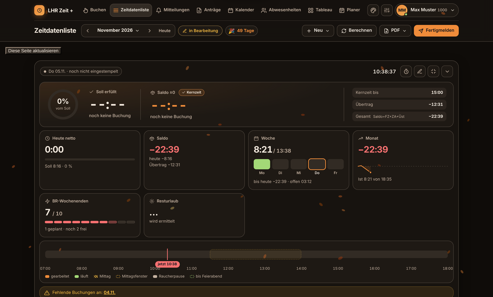
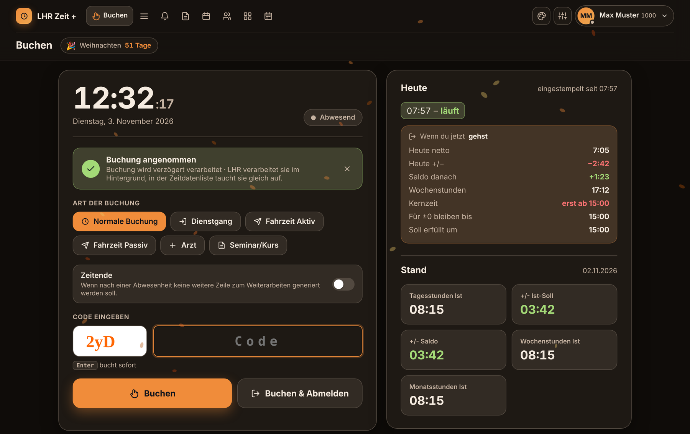
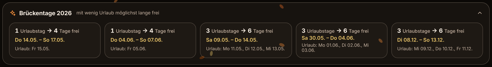
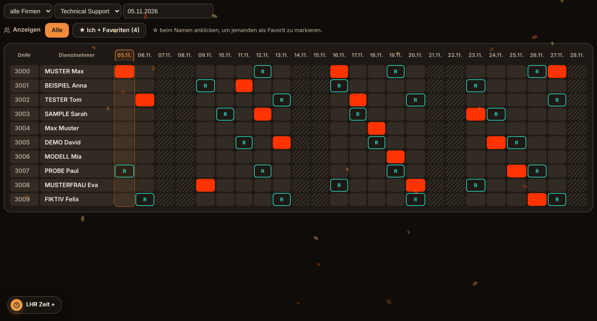
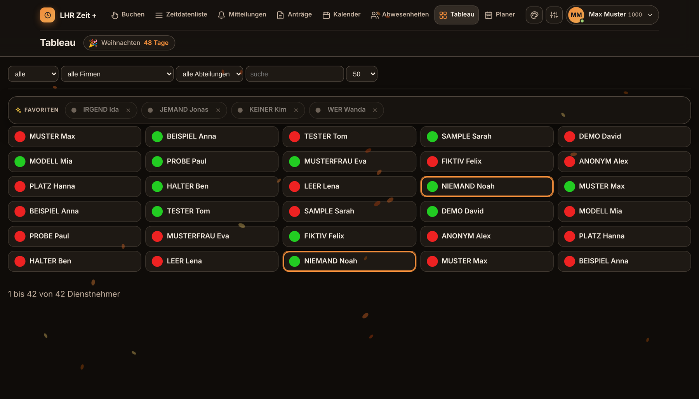
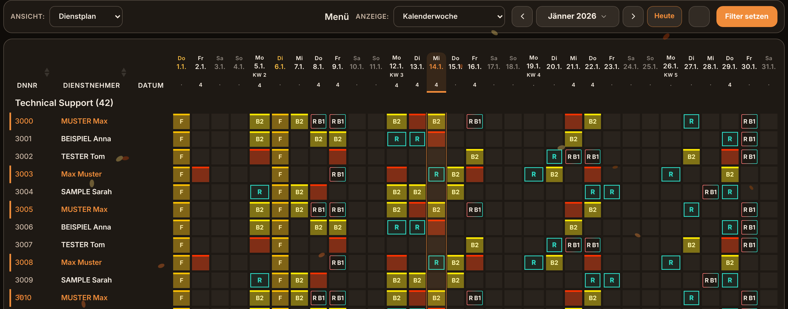

# LHR Zeit +

Tampermonkey-Script, das das **LHR SelfService** (`lohnselfservice/Self/…`) moderner, übersichtlicher und schlauer macht: Live-Arbeitszeit, Feierabend- und Saldo-Rechner, Team-Übersicht, aufgeräumter Planer, Kalender mit Brückentagen und vieles mehr.
Am LHR-System selbst wird **nichts verändert**: Das Script verändert nur die Anzeige im eigenen Browser und liest die Daten, die LHR ohnehin anzeigt.

> **Aktuelle Version:** steht oben im Script (`@version`) und im Menü unter deinem Namen → „Nach Updates suchen“.

> 🔒 **Alle Screenshots sind Beispieldaten:** Namen, Personalnummern und Zeiten sind erfunden bzw. verfälscht.

---

## Inhalt

1. [Installation](#1-installation)
2. [Updates](#2-updates)
3. [Bedienung – Überblick](#3-bedienung--überblick)
4. [Funktionen pro Seite](#4-funktionen-pro-seite)
5. [Einstellungen](#5-einstellungen)
6. [Daten & Datenschutz](#6-daten--datenschutz)
7. [Fehlerbehebung (FAQ)](#7-fehlerbehebung-faq)
8. [Für Admins / Entwickler](#8-für-admins--entwickler)
9. [Änderungsprotokoll](#9-änderungsprotokoll)

---

## 1. Installation

1. **Tampermonkey** im Browser installieren (Chrome, Edge oder Firefox Web Store).
2. **Chrome / Edge:** unter `chrome://extensions` bzw. `edge://extensions` oben rechts den **Entwicklermodus** einschalten. Bei Tampermonkey auf **Details** gehen und **„Benutzerskripte zulassen“** aktivieren. Ohne diesen Schalter laufen Userscripts seit Chrome 138 nicht.
3. Diesen Link öffnen: **[lhr-zeitplus.user.js](https://raw.githubusercontent.com/raina5505/lhr-zeitplus/main/lhr-zeitplus.user.js)**. Tampermonkey zeigt die Installationsseite, dort auf **Installieren** klicken.
4. LHR SelfService neu laden. Oben erscheint die Leiste **„LHR Zeit +“**.

Es gibt auch eine PDF-Anleitung mit Screenshots (Installation und Bedienung). Die bekommst du beim Ersteller.

## 2. Updates

- Das Script prüft alle **15 Minuten**, ob es eine neue Version gibt. Wenn ja, erscheint oben ein **„Update“-Button**.
- Klick auf **Update**: Ein neuer Tab öffnet die neueste Version, dort in Tampermonkey auf **„Aktualisieren“** klicken. Danach die LHR-Seite neu laden.
- Manuell geht's über **Klick auf deinen Namen → „Nach Updates suchen“**.
- Klappt das nicht (z. B. wegen Firmen-Proxy), dann Tampermonkey-Symbol → **Dashboard** → bei „LHR Zeit+“ auf das Datum unter „Letzte Aktualisierung“ klicken.

## 3. Bedienung – Überblick

| Bereich | Was es macht |
|---|---|
| **Obere Leiste** | Navigation (Buchen, Zeitdatenliste, Mitteilungen, Anträge, Kalender, Abwesenheiten, Tableau, Planer), Theme-Wechsel 🎨, Einstellungen ⚙, Menü unter deinem Namen (Hilfe, Updates, Sprache, Abmelden). |
| **Zweite Zeile** | Seitentitel, Monats-/Zeitraum-Navigation, Countdown (z. B. „Weihnachtsfeier 42 Tage“), Aktionen wie Neu, Berechnen, PDF, Fertigmelden. |
| **Themes** | Mehrere Farbschemata mit Effekten (Blätter, Schnee, Sterne …). Die Effekte laufen auf der Grafikkarte, damit auch langsame Laptops flüssig bleiben. |
| **Hover** | Fast überall gibt es Tooltips mit Details, wenn man mit der Maus drüberfährt. |

## 4. Funktionen pro Seite

### Zeitdatenliste (Dashboard)
- **Live-Kacheln** (frei anordnen und ein-/ausblenden unter ⚙ → Layout):
  - **Heute netto:** Arbeitszeit nach Pausenabzug, Fortschritt zum Soll.
  - **Saldo:** Gleitzeitsaldo inklusive heute, live.
  - **Woche / Monat:** Ist/Soll, Tagesbalken, Saldo-Verlauf.
  - **Mittagspause / Raucherpausen:** größte Lücke im Mittagsfenster, Abzug bis zur Pflichtpause.
  - **Gehen um …:** Was passiert mit dem Saldo, wenn ich um X Uhr gehe?
  - **Resturlaub** mit Umschalter **Monat / Jahr**: *Monat* = LHR-Resturlaub per Monatsende, *Jahr* = Resturlaub per Jahresende aus dem Kalender (also was noch nicht eingetragen ist), mit verplant/beantragt.
  - **Stempelblöcke**.
  - **Wochenend-Dienste:** Wochenenden, an denen du **tatsächlich gearbeitet** hast in den **letzten 365 Tagen** (laut KV IT § 5 höchstens **10 Wochenenden in 12 Monaten**, rollierend gezählt; im Tooltip steht, wann das älteste wieder herausfällt). Gezählt wird nur gestempelte Arbeit in der **Wochenendruhe nach ARG § 3**, also Samstag ab 13:00 bis Montag 01:00. Reine Rufbereitschaft (B1/B2) ohne Einsatz zählt **nicht**. Hell dargestellt sind kommende Wochenenden mit geplanter Bereitschaft, die zählen erst bei einem Einsatz. Beim Drüberfahren erscheint die Liste mit den gearbeiteten Stunden. Ab 9 wird es orange, über 10 rot.
- **Feierabend-Rechner:** Soll erfüllt um, Saldo ±0 um, 10-h-Grenze. **Kernzeit** (Mo–Do 15:00, Fr 12:00) wird berücksichtigt.
- **Gesamt** = Saldo + FZSA + FZSP + ZA + Überstunden 50 % × 1,5 + 100 % × 2.
- **Bereitschaft** (Arbeitsmodell EITBR): Soll 5 h, ohne Pflichtpause. In der Liste wird an Bereitschaftstagen keine Mittagspause markiert. Bereitschaft am Wochenende oder Feiertag wird wie ein Arbeitstag angezeigt (nicht ausgegraut).
- **Liste:** schöne Tagesliste. Der Verlauf-Balken zeigt normal 06–19 Uhr und erweitert sich automatisch, wenn im Monat früher oder später gestempelt wurde (z. B. Bereitschaft am Abend). Remote = türkiser Rahmen, Bereitschaft = roter Rahmen, Bereitschaft + Remote = Rahmen, der rot/türkis im Uhrzeigersinn durchläuft.
- **Team-Leiste:** Favoriten heute/morgen: *verfügbar* (Büro/HO) oder *abwesend*.
  - **B1 / B2** (rot umrandet, vor dem Punkt): Die Person hat an dem Tag Bereitschaft. Kommt aus dem Planer, wird im Hintergrund alle paar Stunden und bei jedem Planer-Besuch aktualisiert.
  - **Punkt vor dem Namen:** 🟢 eingestempelt, 🔴 nicht eingestempelt. Kommt live aus dem Tableau, wird alle 20 s aktualisiert.
  - **↻** aktualisiert sofort: Der Kreis dreht sich, danach kommt „✓ aktuell“.
- **Erinnerungen:** Kaffeepause, Daily usw. als Browser-Benachrichtigung.

### Buchen

- Große Uhr, Buchungsarten als Buttons, Code-Feld mit Enter zum Buchen.
- Rechts **„Wenn du jetzt gehst“**: Heute netto, **Heute +/−**, Saldo danach, **Wochenstunden** (live), Kernzeit-Status.
- Darunter der **Stand** von LHR (Stichtag gestern) als Kacheln.

### Mehrfacherfassung
- **Vorschau**, wie die Tage danach in der Zeitdatenliste aussehen (Zeitachse passt sich an, auch für Abend-Einsätze). Bei vielen Zeilen scrollt der Dialog, die Buttons bleiben unten stehen. Die Vorschau mit Warnungen bei Überschneidungen, Wochenenden, Feiertagen usw.

### Kalender
- Jahresansicht mit Farben aus LHR, Bereitschaftstagen (dünner roter Rahmen), Remote (türkis), BR + Remote (Neon-Rahmen).
- **Urlaub halbtags** (in LHR „… halb…“) wird schräg halb gefüllt mit **½** angezeigt und zählt überall als **0,5 Tage** (gebucht, verplant, beantragt, Monats-Zähler).
- **Resturlaub-Kachel:** Resturlaub, gebucht und verplant.
- **Brückentage:** Es werden nur echte Brücken zwischen Feiertag und Wochenende vorgeschlagen (1–3 Arbeitstage). Eigener Urlaub zählt nicht mit, schon komplett genommene Brücken verschwinden.

  

### Abwesenheitsübersicht

- Öffnet immer **deine eigene Abteilung** (wird aus dem Tableau gelernt).
- Moderne Rasteransicht, alle LHR-Farben (Urlaub rot usw.), R = Remote.
- **Heutige Spalte** ist eingerahmt. Kopf und Spalten richten sich automatisch neu aus, wenn sie auseinanderlaufen.
- **☆ beim Namen** markiert jemanden als Favorit. **„Ich + Favoriten“** zeigt eine kompakte Übersicht mit allen Abwesenheiten, auch für Favoriten aus anderen Abteilungen.

### Tableau

- Karten-Ansicht, Detail erst nach Klick auf eine Person.
- Startet immer mit deiner Abteilung. Dein eigener Eintrag wird über die Personalnummer markiert.
- Favoriten aus anderen Abteilungen erscheinen oben mit Status.

### Planer

- Saubere, ruhige Farben. **B1/B2 stehen direkt im Kästchen**, R = Remote (türkiser Rahmen), R + B = rot/türkiser Rahmen.
- **Eigene Monatsnavigation:** ‹ Monat ›, Monatsauswahl (Klick auf den Monat), **Heute**. Der Planer öffnet immer im aktuellen Monat.
- **Datumszeile bleibt oben stehen**, heutige Spalte ist eingerahmt.
- Kleine Zahl unter dem Datum = so viele Personen sind an dem Tag **weg** (ab 15 % orange, ab 30 % rot). Beim Drüberfahren gibt's die Aufteilung nach Abwesend, Remote, Bereitschaft und Feiertag.
- **Gesamt verplant:** *Köpfe* = Personen mit Eintrag, *Tage* = Anzahl Einträge (z. B. Feiertag + Bereitschaft = 2).
- **Hover** auf ein Kästchen zeigt in einem kleinen Kästchen, was an dem Tag ist, mit Datum und Name.

## 5. Einstellungen

⚙ öffnet die Einstellungen:
- **Layout:** Kacheln ein-/ausblenden, breit/schmal, Reihenfolge. Auch per Drag & Drop direkt im Dashboard („Im Dashboard anordnen“).
- **Theme & Effekte:** Effekt an/aus, Menge, nur Dashboard oder ganze Seite.
- **Arbeitszeit:** Kernzeit, Pausenregeln, Bereitschafts-Arbeitsmodell (Standard `EITBR`), Bereitschaftsbeginn, Höchstarbeitszeit.
- **Erinnerungen:** Zeiten und Sound.

Alle Einstellungen werden im Browser gespeichert (siehe unten).

## 6. Daten & Datenschutz

- Alles bleibt **lokal im Browser** (localStorage der LHR-Seite). Es wird **nichts an externe Server** geschickt.
- Einzige externe Verbindung: die Update-Prüfung bei **GitHub** (`api.github.com` / `raw.githubusercontent.com`). Dabei wird nur die Script-Datei abgerufen.
- Für die Team-Funktionen öffnet das Script **unsichtbar** LHR-Seiten (Abwesenheitsübersicht, Tableau) im Hintergrund. Dort stellt es Filter kurz um und danach wieder zurück. Deine eigene Tableau-Ansicht (Abteilung, Status, Einträge/Seite) wird beim Öffnen wiederhergestellt.

| Speicher-Schlüssel | Inhalt |
|---|---|
| `zplus_settings` | alle Einstellungen, Layout, Favoriten |
| `zplus_team` | Abwesenheiten der Favoriten (für Team-Leiste & Übersicht) |
| `zplus_tstat` | Stempel-Status der Favoriten (aus dem Tableau) |
| `zplus_br`, `zplus_brm` | erkannte Bereitschaftstage / bereits eingelesene Monate |
| `zplus_brplan` | eigene geplante Bereitschaften aus dem Planer |
| `zplus_teambr` | Bereitschaften (B1/B2) aller Personen aus dem Planer (±6 Wochen) |
| `zplus_wework` | gestempelte Minuten in der Wochenendruhe je Tag (für die Kachel Wochenend-Dienste) |
| `zplus_leg` | Farblegende aus dem Kalender (für Hover-Texte) |
| `zplus_upd` | Ergebnis der letzten Update-Prüfung |
| `zplus_fired` | heute schon ausgelöste Erinnerungen |

**Alles zurücksetzen:** In LHR `F12` → Konsole → `Object.keys(localStorage).filter(k=>k.startsWith('zplus_')).forEach(k=>localStorage.removeItem(k))` → Seite neu laden.

## 7. Fehlerbehebung (FAQ)

| Problem | Lösung |
|---|---|
| Script läuft gar nicht | Tampermonkey aktiv? **„Benutzerskripte zulassen“** bzw. Entwicklermodus an (siehe Installation)? Script in Tampermonkey eingeschaltet? |
| „Update“ erscheint nicht | Klick auf deinen Namen → „Nach Updates suchen“. Notfalls Tampermonkey-Dashboard → Datum anklicken (siehe Updates). |
| Team-Leiste leer / „keine Daten“ | Favoriten mit ☆ in der Abwesenheitsübersicht markieren und in der Team-Leiste auf ↻ klicken. |
| Keine grünen/roten Punkte | Kommt aus dem Tableau. Einmal ↻ klicken, unten muss „● Live hh:mm:ss“ stehen. |
| Abteilung springt nicht automatisch | Einmal das Tableau öffnen, damit das Script deine Abteilung lernt. |
| Hover zeigt nur „Abwesenheit“ | Einmal den **Kalender** öffnen. Daraus wird die Farblegende (Urlaub, Krankenstand …) gelernt. |
| Planer/Abwesenheiten verrutscht | Seite neu laden. Bleibt es, bitte Screenshot an den Ersteller. |
| Seite ruckelt | Effekte laufen schon auf der Grafikkarte. Bei sehr alten Laptops unter ⚙ die Effekt-Menge auf „wenig“ stellen. |
| Etwas sieht falsch aus | Die originale LHR-Seite zeigt sich, wenn man das Script in Tampermonkey kurz ausschaltet. Fehler bitte mit Screenshot melden. |

## 8. Für Admins / Entwickler

- **Eine Datei:** `lhr-zeitplus.user.js`, `@grant none` (läuft im Seitenkontext), `@run-at document-start`.
- **Updates ausrollen:** Änderung committen, `@version` **und** die Konstante `VERSION` im Script hochzählen, auf `main` pushen. Alle Nutzer bekommen sie über den Update-Button bzw. Tampermonkeys `@updateURL`.
- Die Update-Suche holt den letzten Commit über die GitHub-API und öffnet die Datei mit **Commit-Kennung** im Link. So stört kein Zwischenspeicher.
- **Aufbau:** Die eigene UI läuft in Shadow-DOM-Hosts (`#zp-shell-host`, `#zp-host`, `#zp-team-host` …). Die LHR-Seiten werden per CSS (`html.zp-…`-Klassen) umgestaltet. Hintergrund-iframes heißen `zp-…`, darin startet das Script nicht.
- **Diagnose:** In der Konsole `ZeitPlus.diag()` aufrufen (Version, Seite, letzter Fehler).
- **Pflege dieser Anleitung:** Bei jeder Änderung am Script wird dieses README mitgepflegt (Funktionen + Änderungsprotokoll).

## 9. Änderungsprotokoll

| Version | Änderungen |
|---|---|
| 5.27.0 | Team-Leiste schneller: Hintergrund-Seiten laden nacheinander (Stempel-Status zuerst), „Aktualisiere …“ nur noch nach Klick auf ↻, Ersatz-Abfrage falls der Live-Status hängt. |
| 5.26.9 | Kalender: **Urlaub halbtags** erkennbar (½, halb gefüllt) und zählt als 0,5 Tage. |
| 5.26.8 | Zeitdatenliste: an Bereitschaftstagen (z. B. Sonntag) wird keine Mittagspause mehr erkannt/angezeigt. |
| 5.26.7 | Team-Leiste: **B1/B2-Kennzeichen** bei Kollegen mit Bereitschaft (aus dem Planer). |
| 5.26.6 | Mehrfacherfassung: Dialog scrollt bei vielen Zeilen, Buttons (Beantragen/Abbrechen) bleiben unten sichtbar; Vorschau-Achse erweitert sich bei späten Zeiten (z. B. bis 22:30). |
| 5.26.5 | Kachel Resturlaub: Umschalter **Monat / Jahr** (Jahr = noch nicht eingetragener Resturlaub bis Jahresende aus dem Kalender). |
| 5.26.4 | Wochenend-Dienste zählen rollierend über die **letzten 365 Tage** statt ab 1.1., inkl. Hinweis, wann das älteste herausfällt. |
| 5.26.3 | Zeitdatenliste: Verlauf-Balken erweitert sich automatisch, wenn früher/später gestempelt wurde (z. B. Bereitschaft bis 24 Uhr); 24:00 und Einsätze über Mitternacht korrekt. |
| 5.26.2 | Kachel **Wochenend-Dienste**: zählt nur noch gestempelte Arbeit Sa ab 13:00 bis Mo 01:00 (ARG § 3, KV IT § 5), nicht mehr bloße B1/B2-Tage. |
| 5.26.1 (Doku) | README mit anonymisierten Screenshots (keine echten Namen/Zeiten). |
| 5.26.1 | Menü unter dem Namen: **„Hilfe zu LHR Zeit +“** öffnet diese Anleitung. Planer: Wechsel der Anzeige wird respektiert. |
| 5.26.0 | Neue Kachel **BR-Wochenenden** (max. 10/Jahr, gearbeitet + geplant aus Zeitdatenliste und Planer). |
| 5.25.8 | Stempel-Status live alle 20 s, ↻ dreht sich mit Rückmeldung. |
| 5.25.7 | Abwesenheiten: Kopf und Spalten richten sich automatisch aus. |
| 5.25.6 | Effekte als GPU-Animationen (ca. 7× weniger Prozessorlast), Abwesenheiten öffnen die eigene Abteilung. |
| 5.25.2–5.25.4 | Team-Leiste: grüner/roter Stempel-Punkt aus dem Tableau. |
| 5.25.1 | Brückentage nur aus Wochenende + Feiertag. |
| 5.25.0 | Neues Messer-und-Gabel-Symbol. |
| 5.24.8–5.24.9 | Bereitschaft am WE/Feiertag nicht ausgegraut, BR + Remote mit laufendem Rahmen. |
| 5.24.5–5.24.7 | Heutige Spalte in Planer und Abwesenheiten, rote Abwesenheiten wieder sichtbar, B2 nicht mehr als „Arzt“. |
| 5.24.4 | Planer: eigene Monatsnavigation, öffnet im aktuellen Monat. |
| 5.24.2–5.24.3 | Buchen: Live-Werte bei „Wenn du jetzt gehst“. Planer scrollt flüssiger. |
| 5.24.0 | Update-Suche über Commit-Link. |
| 5.23.x | Planer komplett überarbeitet (Farben, B1/B2, Kopfzeile, Hover, Summenzeile). |
